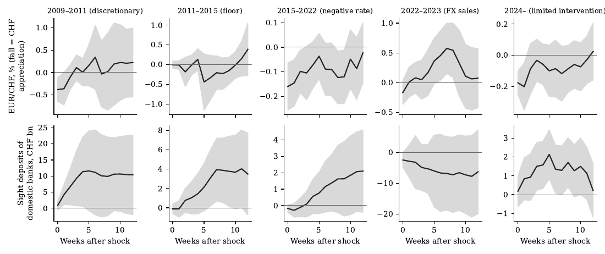

# Safe-Haven Inflows, Foreign Exchange Intervention and Domestic Credit

Data and code behind every table and figure of

> Aslan, I. (2026). Safe-haven inflows, foreign exchange intervention and domestic credit: Evidence from Switzerland and Denmark. Working paper, November 2026. [Abstract and PDF](https://ilkeraslan.github.io/papers/safe-haven-inflows-and-domestic-credit.html)



When global risk aversion rises the Swiss franc appreciates, and the Swiss National Bank has at times bought foreign currency on a large scale to resist it. The paper asks where the inflow ends up. Global risk-off shocks are identified from innovations in the VIX and traced with local projections across five intervention regimes between 2009 and 2026. When the exchange rate is held, the inflow shows up as sight deposits of banks at the central bank; banks keep these as liquid assets and domestic mortgage and total lending do not respond. Denmark's defence of its peg in 2015, with an observed daily intervention series, gives the same result.

## Main results

| | Estimate |
|---|---|
| Franc against the euro after a one-standard-deviation risk-off shock, outside the 2011–2015 floor | appreciates by about 0.17 per cent on impact |
| Same shock under the floor | no response |
| Sight deposits of domestic banks at the SNB, 2009–2011 | about CHF 11 billion higher within four weeks |
| Sight deposits under the floor | about CHF 4 billion higher within eight weeks |
| Danish foreign currency purchases, January–February 2015 | about 14 per cent of GDP |
| Mortgage credit per unit of central bank money, both countries | between −0.10 and 0.09; values above about one third are excluded |

## Files

| Path | Content |
|---|---|
| `data/` | The source files as downloaded (see Data) |
| `code/build.py` | Weekly, monthly and quarterly data sets and the risk-off shocks |
| `code/lp.py` | Baseline local projections by regime |
| `code/robust_figs.py` | Robustness checks and Figures 1 to 3 |
| `code/tables.py` | Tables 1 to 4, 10 and 12 |
| `code/difftest.py` | Test of equal credit responses across regimes |
| `code/ext.py`, `code/ext_tables.py` | Bank balance sheets, bank groups, pre-trends and shock exogeneity (Tables 5, 6 and 11) |
| `code/denmark.py` | Danish analysis (Tables 7 and 8, Figure 4) |
| `code/boot.py` | Block-bootstrap intervals for lending per unit of central bank money (Table 9) |
| `code/ccyb.py` | Mortgage responses with and without the countercyclical capital buffer in force |
| `results/` | Outputs of the code: intermediate data (`*.csv`), estimates (`*.json`), table bodies (`tab_*.tex`) and figures (`fig_*.pdf`) |

Tables and figures by file: Table 1 `tab_desc`, 2 `tab_currencies`, 3 `tab_weekly`, 4 `tab_monthly`, 5 `tab_bs`, 6 `tab_grp`, 7 `tab_dkw`, 8 `tab_dkm`, 9 `tab_boot`, 10 `tab_robust`, 11 `tab_pre`, 12 `tab_mrobust`; Figure 1 `fig_shock`, 2 `fig_weekly_regimes`, 3 `fig_monthly`, 4 `fig_denmark_2015`.

## Running the code

```
python -m pip install -r requirements.txt
cd code
python build.py
python lp.py
python robust_figs.py
python tables.py
python difftest.py
python ext.py
python ext_tables.py
python denmark.py
python boot.py
python ccyb.py
```

Run the scripts from the `code` folder in this order; together they take about two minutes and reproduce the files in `results/`. They were last checked with Python 3.13, pandas 3.0, NumPy 2.5, statsmodels 0.15 and Matplotlib 3.11.

## Data

All series are public and were retrieved in November 2026.

| File | Source |
|---|---|
| `snb_monthly.csv` | SNB data portal, tables `snbbipo` (SNB balance sheet), `devkum` (exchange rates), `bakredinausbm` (domestic loans by bank category and type), `snbgwdzid` (policy rate, SARON), `plkopr` (CPI) |
| `snb_weekly.csv` | SNB table `snbgwdchfsgw` (sight deposits at the SNB) |
| `snb_houseq.csv` | SNB table `plimoinchq` (residential property price indices) |
| `snb_fxtr.csv` | SNB table `snbfxtr` (SNB foreign exchange transactions, from 2020) |
| `snb_mmrates.csv` | SNB table `zimoma` (money-market rates) |
| `snb_bankbs.csv` | SNB table `babilpobm` (monthly bank balance sheets by residence, currency and bank group) |
| `fred_daily.csv` | FRED: VIXCLS (Cboe), STLFSI4, DEXSZUS, DEXUSEU, DEXNOUS, DEXSDUS, DEXJPUS, DGS10, DGS2, DTWEXBGS, DCOILBRENTEU |
| `dk_dnvali.csv` | Statistics Denmark StatBank, table DNVALI (Danmarks Nationalbank foreign exchange interventions) |
| `dk_dnprnd.csv` | StatBank DNPRND (banks' net position at Danmarks Nationalbank) |
| `dk_dnvald.csv` | StatBank DNVALD (krone exchange rates) |
| `dk_dnrentd.csv` | StatBank DNRENTD (Danmarks Nationalbank interest rates) |
| `dk_dnruuri.csv` | StatBank DNRUURI (mortgage-bank loans by sector) |
| `dk_dnruupi.csv` | StatBank DNRUUPI (bank loans by sector) |

## Citation

Please cite the paper. GitHub's "Cite this repository" button gives the reference in APA and BibTeX formats.

## Licence

Code: MIT licence (see `LICENSE`). The data are from the public sources listed above and remain subject to their terms.

## Author

Ilker Aslan, Lecturer, Kalaidos University of Applied Sciences, Zürich
[ORCID 0000-0001-9241-9420](https://orcid.org/0000-0001-9241-9420) · [ilkeraslan.github.io](https://ilkeraslan.github.io)
